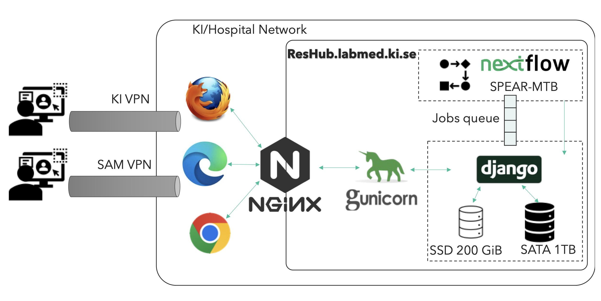

# microwarrior (ResHub)

A Django web application for running and browsing results of the
[spear-MTB](https://github.com/Karolinska-AMR/spear-mtb) pipeline, which predicts
drug resistance in *Mycobacterium tuberculosis* from whole-genome sequencing data.

Users upload paired-end FASTQ files, the run is queued with Celery and executed by
spear-MTB (Nextflow), and the resulting report is imported into the database where
samples, lineages and resistance mutations can be explored against the WHO,
CRyPTIC and TB-Profiler catalogues. The interface is available in Swedish (default)
and English.

It was deployed as **ResHub** at `reshub.labmed.ki.se` (Karolinska Institutet).

## ResHub server



The server sits inside the KI/hospital network and is reached by users over the
KI VPN or the SAM VPN. nginx terminates TLS and forwards requests to gunicorn,
which runs Django. Django puts jobs on the Celery queue (RabbitMQ), and the
worker runs SPEAR-MTB with Nextflow on the same machine. Data is split over two
disks: a 200 GiB SSD for the database and active data (uploads, Nextflow work
directory, assets) and a 1 TB SATA disk for the archive, raw reads and logs.

Details in [docs/deployment.md](docs/deployment.md).

## Repository layout

```
microwarrior/      Django project: settings, urls, celery app, .env (not in git)
users/             login, password change, user management
dashboard/         landing page, job submission, job queue and overview charts
iomanager/         chunked FASTQ upload
flowrunner/        Celery task that runs spear-MTB and imports its report
samplesbrowser/    results browser and the core data models
catalogmanager/    mutation catalogue browser with curator notes
settings/          admin page: JSON import, sample deletion, users
templates/         shared base templates
locale/            project-wide translations (sv, en)
deploy/            systemd, nginx and RabbitMQ configuration
scripts/           standalone maintenance scripts working on the SQLite DB
docs/              documentation
```

## Quick start (development)

```bash
conda env create -f environment.yaml
conda activate microwarrior

cp .env.example microwarrior/.env      # then edit the values
python manage.py migrate
python manage.py createsuperuser
python manage.py runserver
```

Running jobs additionally needs RabbitMQ, a Celery worker and a working spear-MTB
installation:

```bash
celery -A microwarrior worker -l info -E --concurrency 1
```

Users log in with their **e-mail address**, so give the superuser an e-mail.

## Documentation

- [docs/architecture.md](docs/architecture.md): how the code is organised, the
  data model and the job life cycle
- [docs/deployment.md](docs/deployment.md): production setup (nginx, gunicorn,
  Celery, RabbitMQ), configuration and backup/migration notes

## Status

The core workflow (upload, run, browse results, catalogue notes, administration)
is in use. Some parts are unfinished: the help page is a placeholder, and the
news, publications and updates sections of the home page have no content yet.
See [docs/architecture.md](docs/architecture.md#unfinished-parts).

## License

GPL-3.0, see [LICENSE](LICENSE).
