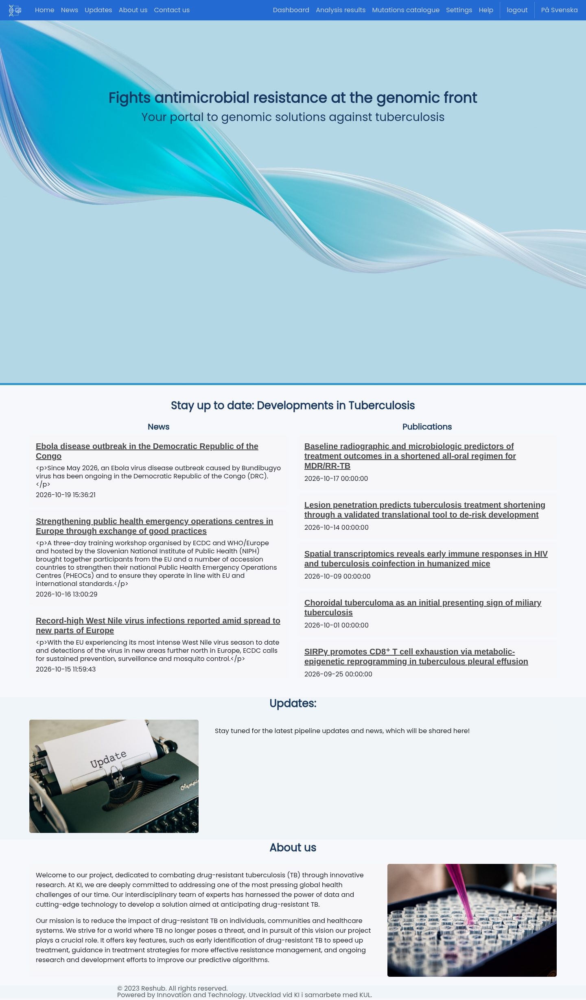
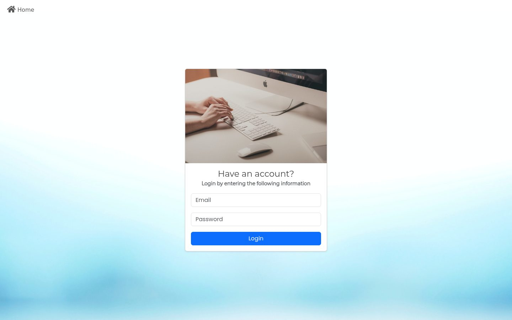
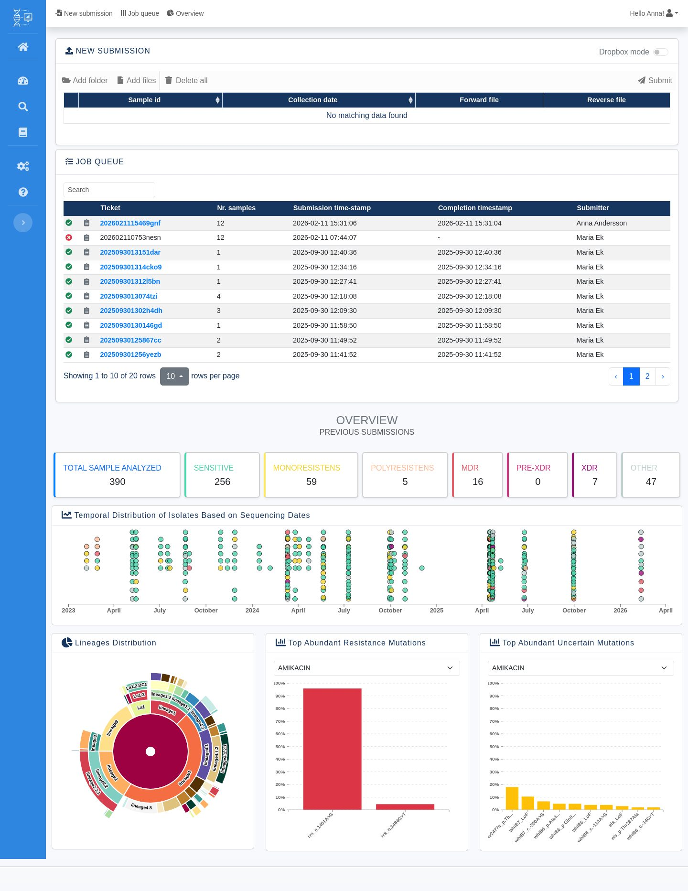
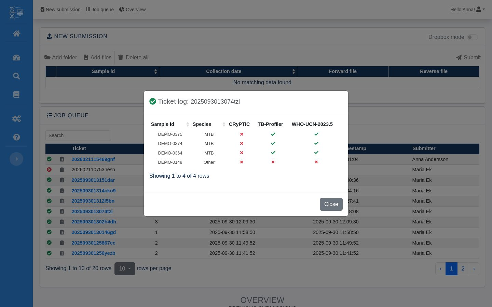
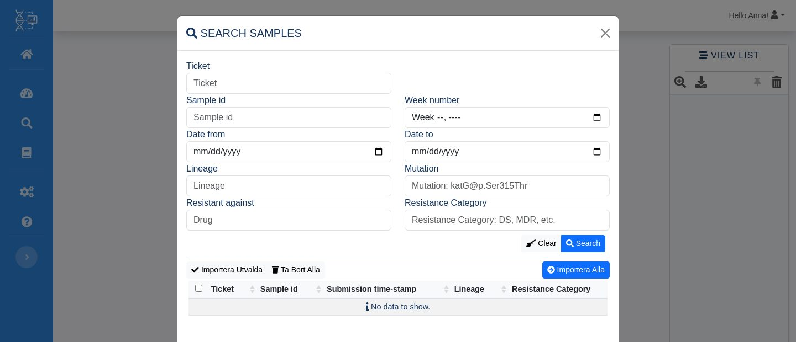
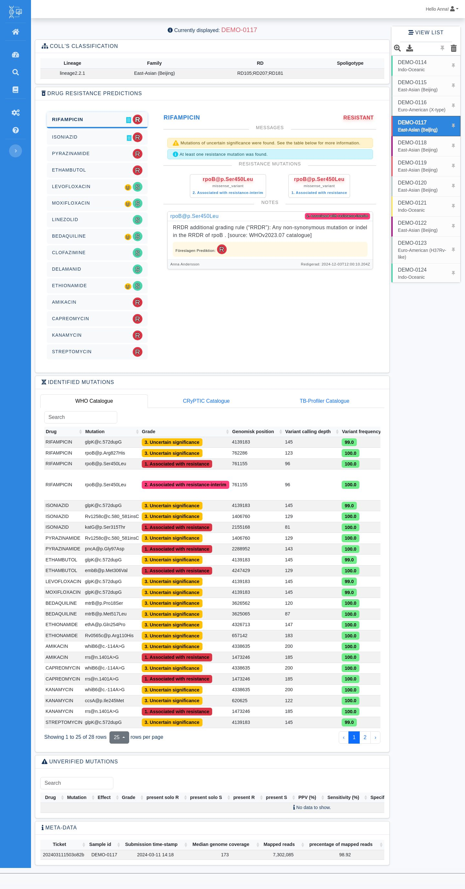
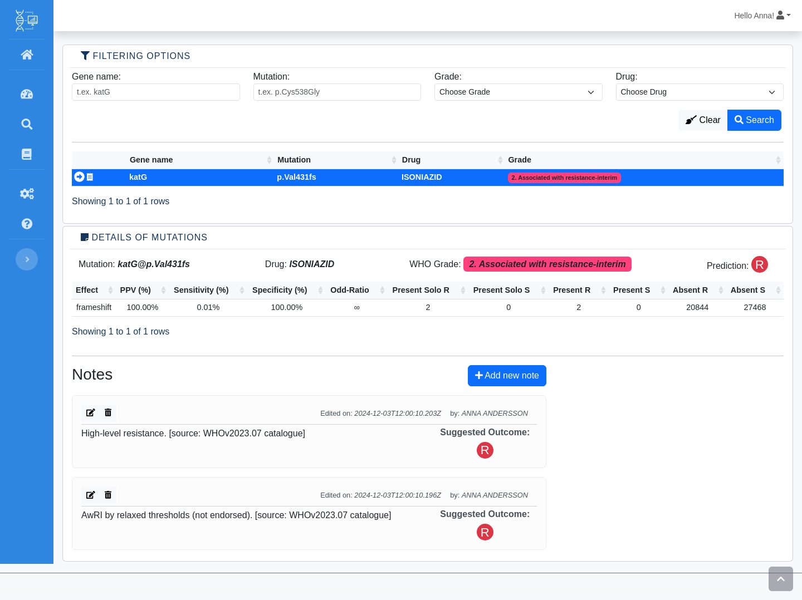
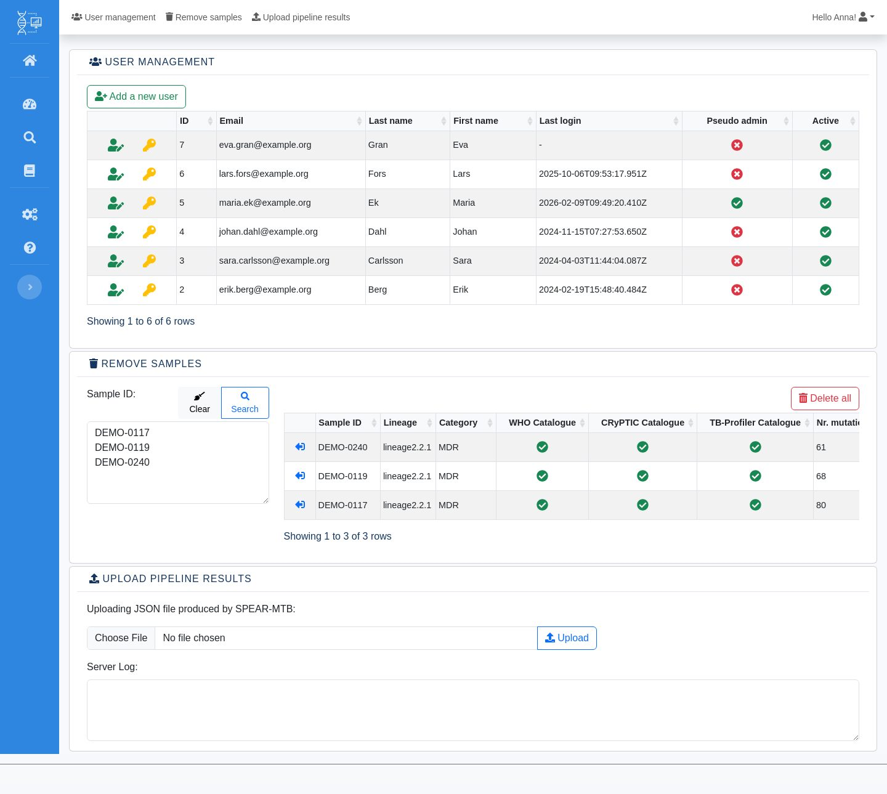

# User guide

A walk-through of the ResHub pages. The screenshots were taken from a copy of
the production database in which sample IDs (`DEMO-xxxx`), user names and e-mail
addresses were replaced; results, lineages and mutations are real.

The interface is in Swedish by default. Use the language switch (user menu, or
*På Svenska / In English* on the home page) to change it.

The left sidebar links to: Home, Dashboard, Analysis results (samples browser),
Mutation catalogue, Settings (staff only) and Help.

## 1. Home

The public landing page. *News* and *Publications* are loaded live in the browser
from RSS feeds (ECDC, ScienceDaily, Nature and a PubMed search on tuberculosis).
The *Updates* section is a placeholder.

## 2. Login

Log in with your **e-mail address** and password. Accounts are created by an
administrator on the Settings page; there is no self-registration. A logged-in user
can change their password from the user menu (top right).

## 3. Dashboard

### New submission
1. Click **Add files** (or **Add folder** to pick a whole directory).
2. Files must be paired-end Illumina reads named `<sample>_1.fastq.gz` and
   `<sample>_2.fastq.gz`. The pairs are matched by name, one row per sample.
3. Optionally set the **collection date** of each sample.
4. Click **Submit**. Sample IDs that are already analysed or are waiting in the
   queue are rejected. The files are uploaded in chunks and the job is added to
   the queue under a new *ticket*.

### Job queue
Lists recent jobs with their status icon (running, enqueued, completed, failed),
number of samples, submission and completion time, and who submitted them.

- Click a **ticket** to open its samples in the samples browser.
- Click the **log icon** to see the result per sample:

*Species* is `MTB` when the sample was identified as *M. tuberculosis* and
analysed, `Other` otherwise. The catalogue columns show whether the sample passed
the quality checks of each catalogue.

### Overview
Statistics over all analysed samples:

- counts per resistance category (sensitive, mono-, poly-resistant, MDR, pre-XDR,
  XDR, other)
- samples over time by sequencing date, coloured by category
- lineage distribution (sunburst, click to zoom)
- most frequent resistance (`R`) and uncertain (`U`) WHO mutations per drug

## 4. Analysis results (samples browser)

Samples are added to the **View list** on the right, either by opening a ticket
from the dashboard or with the search button (magnifier):

Search by ticket, sample ID, week, date range, lineage, mutation, drug or
resistance category, then **Import selected** or **Import all**. Pinned samples
stay in the list when the rest is cleared (trash icon).

Click a sample in the list to show its report:

- **Coll's classification**: lineage, family, region of difference (RD) and
  spoligotype.
- **Drug resistance predictions**: one row per drug with the prediction
  (`R` resistant, `U` uncertain, `S` susceptible). Selecting a drug shows the
  messages, the resistance mutations behind the call and any curator notes from
  the mutation catalogue.
- **Identified mutations**: all variants, in one tab per catalogue (WHO, CRyPTIC,
  TB-Profiler), with grade, genomic position, depth and allele frequency.
- **Unverified mutations**: WHO catalogue entries that could not be confirmed for
  the sample.
- **Meta-data**: ticket, submission time and sequencing QC (median genome
  coverage, mapped reads).

## 5. Mutation catalogue

Search the WHO catalogue by gene, mutation, grade and drug. Selecting a row shows
the catalogue statistics for that mutation (PPV, sensitivity, specificity, odds
ratio and solo/present counts) and its **notes**.

Notes let curators record a comment and a suggested prediction for a mutation.
They are shown in the sample report wherever the mutation occurs. Notes can be
edited and deleted; earlier versions are kept in the database.

## 6. Settings (staff only)

- **User management**: add users, edit their name and e-mail, and reset
  passwords. The table shows each user's last login, staff ("pseudo admin") and
  active status.
- **Remove samples**: paste sample IDs (one per line) and search. Use the arrow
  icon to take a sample off the list, then **Delete all** to delete the listed
  samples and all their results from the database (after a confirmation).
- **Upload pipeline results**: import a spear-MTB JSON report produced outside
  ResHub. The server log shows what was imported and any errors.

## 7. Help

The Help page is a placeholder ("under construction").
